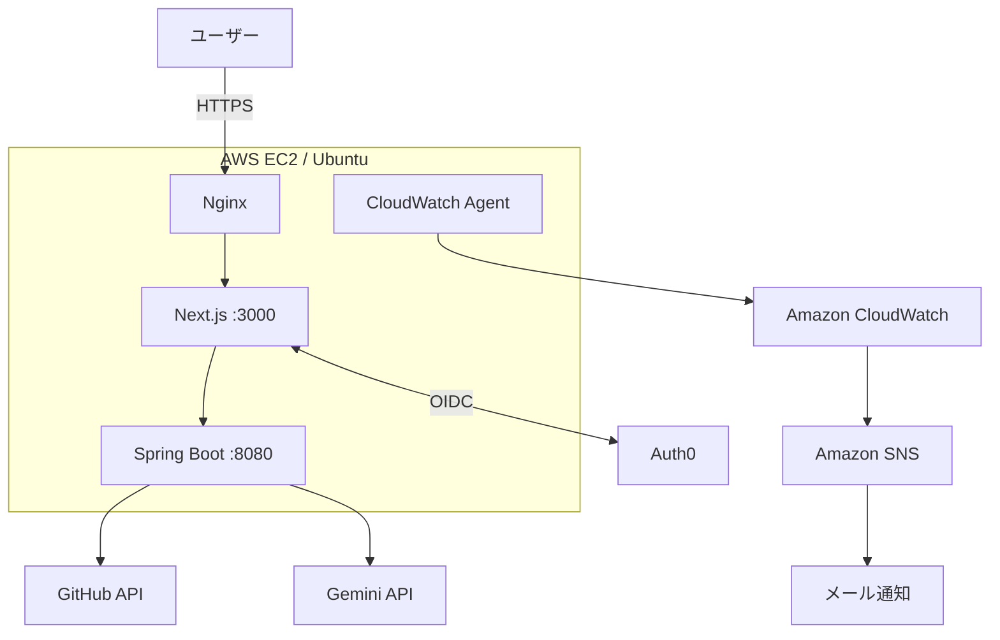
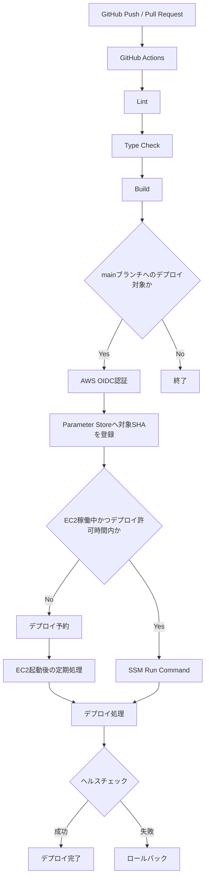

# Portfolio Frontend

Next.js App Router / TypeScript / Tailwind CSS を使用したエンジニア向けポートフォリオサイト。

プロフィール、技術スキル、開発実績の公開に加え、GitHub APIによる開発状況の可視化、生成AIによる対話・開発進捗分析機能を提供する。

## 公開URL

https://toyohashi-portfolio.duckdns.org

稼働時間：毎日 08:00〜20:00（JST）

AWSの運用コスト削減のため、稼働時間外はEC2インスタンスを停止する。

## 技術スタック

### アプリケーション・開発基盤

| 分類 | 使用技術 |
|---|---|
| フレームワーク | Next.js / App Router |
| 開発言語 | TypeScript |
| スタイリング | Tailwind CSS |
| 実行環境 | Node.js 22 |
| 認証 | Auth0 / OAuth 2.0 / OpenID Connect |
| バックエンド | Java / Spring Boot |
| 外部API | GitHub REST API / GraphQL API |
| 生成AI | Google Gemini API / RAG |
| OS | Ubuntu Server 24.04 LTS |
| Webサーバー | Nginx |
| DNS | DuckDNS |
| SSL/TLS | Let's Encrypt / Certbot |
| CI/CD | GitHub Actions |
| プロセス管理 | systemd |
| ログ管理 | rsyslog / logrotate |
| バージョン管理 | Git / GitHub |

### AWSサービス・機能

| 分類 | AWSサービス・機能 | 用途 |
|---|---|---|
| コンピューティング | Amazon EC2 | Next.js・Spring Bootの実行環境（t3.small） |
| ストレージ | Amazon EBS | gp3ボリューム（20 GiB） |
| ネットワーク | Amazon VPC | 仮想ネットワーク・サブネット |
| ネットワーク | Elastic IP | 固定パブリックIPv4アドレス |
| ネットワーク | Security Groups | SSH・HTTP・HTTPSのアクセス制御 |
| 認証・認可 | AWS IAM | IAMロール・ポリシー・OIDC IDプロバイダー |
| 一時認証情報 | AWS STS | GitHub ActionsからのAssumeRoleWithWebIdentityによる一時認証 |
| 運用・デプロイ | AWS Systems Manager | Run Command・カスタムSSMドキュメント・Fleet Manager |
| 設定管理 | AWS Systems Manager Parameter Store | デプロイ対象コミットSHAの管理 |
| スケジュール管理 | Amazon EventBridge Scheduler | EC2の定期起動・停止 |
| メトリクス監視 | Amazon CloudWatch Metrics | CPU・メモリ・ディスクなどの監視 |
| ログ管理 | Amazon CloudWatch Logs | アプリケーション・Nginx・デプロイログの収集 |
| ログ分析 | CloudWatch Logs Insights | ログ検索・エラー分析 |
| 異常検知 | Amazon CloudWatch Alarms | しきい値による異常検知 |
| 可視化 | Amazon CloudWatch Dashboards | メトリクス・ログ・アラームの統合表示 |
| 監視エージェント | Amazon CloudWatch Agent | EC2内部のメトリクス・ログ収集 |
| 通知 | Amazon SNS | 監視アラームのメール通知 |
| コスト管理 | AWS Budgets | 月額予算・実績および予測料金の通知 |
| 請求管理 | AWS Billing and Cost Management | 利用料金・予算管理 |
| AWS操作 | AWS CLI | EC2・SSM・Parameter Storeなどの操作 |

※ AWSの独立したサービスに加え、利用している主要機能・運用ツールも記載する。未導入のAmazon RDS、Amazon S3、Amazon CloudFrontなどは含めない。

## 機能一覧

### ポートフォリオ

- [x] トップページ
- [x] プロフィールページ
- [x] 開発実績ページ
- [x] 技術スキルページ
- [x] ブログページの基本構成
- [x] お問い合わせページの基本構成
- [x] 共通ヘッダー・フッター
- [x] レスポンシブデザイン
- [x] エラー・404・ローディング画面

### 認証・認可

- [x] Auth0 Universal Login
- [x] OAuth 2.0 / OpenID Connect
- [x] Authorization Code Flow + PKCE
- [x] ユーザーログイン・ログアウト
- [x] ユーザー登録
- [x] ソーシャルログイン
- [x] 多要素認証（MFA）
- [x] セッション管理
- [x] 認証済みユーザー向け画面
- [ ] ロールベースアクセス制御（RBAC）
- [ ] 管理者専用画面

### GitHub連携

- [x] リポジトリ情報の取得・表示
- [x] コントリビューショングラフ
- [x] コミット情報の表示
- [x] Issueの進捗表示
- [x] Pull Request情報の表示
- [x] 使用言語の可視化
- [x] 開発状況ダッシュボード

### AI Assistant

- [x] Gemini APIを利用したAIチャット
- [x] RAGによるポートフォリオ情報の参照
- [x] 会話コンテキストの管理
- [x] 回答の参照元表示
- [x] 週間開発進捗分析
- [x] 月間開発進捗分析
- [x] 認証済みユーザー向けAPI連携
- [ ] チャット履歴の永続化
- [ ] ストリーミング応答
- [ ] ユーザー別利用量管理

### 今後の追加機能

- [ ] お問い合わせ送信機能
- [ ] ブログ投稿・編集・削除
- [ ] 管理者ダッシュボード
- [ ] プロフィール編集機能
- [ ] 開発実績管理機能
- [ ] 技術スキル管理機能
- [ ] データベース連携

## システム構成



フロントエンドとバックエンドは同一EC2インスタンス上で稼働する。

外部からのHTTP/HTTPSリクエストはNginxで受け付け、Next.jsへリバースプロキシする。Next.jsおよびSpring Bootのポートは外部へ直接公開しない。

## ディレクトリ構成

```text
portfolio-frontend/
├── .github/
│   └── workflows/
├── public/
├── src/
│   ├── app/
│   ├── components/
│   ├── config/
│   ├── hooks/
│   ├── lib/
│   │   └── api/
│   ├── types/
│   └── proxy.ts
├── .env.example
├── .gitignore
├── package.json
├── package-lock.json
├── tsconfig.json
└── README.md
```

## ローカル開発環境

### 前提条件

- Node.js 22
- npm
- Git
- Auth0アカウント
- Portfolio Backend（API連携時）

### セットアップ

```bash
git clone https://github.com/makoto-toyohashi/portfolio-frontend.git
cd portfolio-frontend
npm ci
```

`.env.example` を参考に `.env.local` を作成し、必要な環境変数を設定する。

### 環境変数

| 環境変数 | 用途 |
|---|---|
| AUTH0_DOMAIN | Auth0テナントドメイン |
| AUTH0_CLIENT_ID | Auth0クライアントID |
| AUTH0_CLIENT_SECRET | Auth0クライアントシークレット |
| AUTH0_SECRET | セッション保護用シークレット |
| APP_BASE_URL | アプリケーションのベースURL |
| AUTH0_AUDIENCE | カスタムAPIの識別子（必要時） |
| API_BASE_URL | Spring Boot APIのベースURL |
| AI_ACCESS_KEY | AI API連携用アクセスキー |

ローカル環境の設定例：

```dotenv
AUTH0_DOMAIN=your-tenant.auth0.com
AUTH0_CLIENT_ID=your-client-id
AUTH0_CLIENT_SECRET=your-client-secret
AUTH0_SECRET=your-generated-secret

APP_BASE_URL=http://localhost:3000
API_BASE_URL=http://localhost:8080/api/v1

AI_ACCESS_KEY=your-ai-access-key
```

実際の認証情報をGitリポジトリへ登録しないこと。

### 開発サーバーの起動

```bash
npm run dev
```

http://localhost:3000

### 品質チェック

```bash
npm run lint
npm run typecheck
npm run build
```

### 本番モードでの起動

```bash
npm run build
npm run start
```

## API連携

Spring Bootとの通信は、Next.jsのサーバー側処理を経由して行う。

APIキーやバックエンド接続情報をブラウザへ公開しない構成とする。

### GitHub API

| メソッド | エンドポイント |
|---|---|
| GET | /api/v1/github/projects |
| GET | /api/v1/github/projects/{name}/progress |
| GET | /api/v1/github/contributions |
| GET | /api/v1/github/dashboard |

### AI API

| メソッド | エンドポイント |
|---|---|
| POST | /api/v1/ai/chat |
| GET | /api/v1/ai/analysis/weekly |
| GET | /api/v1/ai/analysis/monthly |

上記はSpring Boot側のAPIエンドポイントであり、ブラウザから直接呼び出すための公開URLではない。

## CI/CD

GitHub Actionsを使用して、品質チェックおよびAWS EC2への自動デプロイを行う。



### デプロイ制御

- GitHub Actionsによる自動ビルド
- OIDCによるAWS認証
- AWS Systems Managerによるリモートデプロイ
- Parameter Storeによるデプロイ予約管理
- EC2停止中のデプロイ延期
- デプロイ処理の排他制御
- デプロイ前のバックアップ
- ヘルスチェック
- 障害発生時のロールバック
- リトライ回数制限
- 重複デプロイ防止

## AWS運用構成

| AWSサービス | 用途 |
|---|---|
| Amazon EC2 | アプリケーション実行環境 |
| Amazon EBS | ストレージ |
| Elastic IP | 固定IPアドレス |
| Amazon VPC | ネットワーク管理 |
| AWS IAM | 認証・権限管理 |
| AWS Systems Manager | リモートデプロイ |
| Parameter Store | デプロイ予約管理 |
| EventBridge Scheduler | EC2自動起動・停止 |
| Amazon CloudWatch | メトリクス・ログ監視 |
| Amazon SNS | 障害通知 |
| AWS Budgets | 利用料金監視 |

### 監視項目

- CPU使用率
- メモリ使用率
- ディスク使用率
- Swap使用率
- CPUクレジット残量
- EC2ステータスチェック
- ネットワーク通信量
- アプリケーションログ
- Nginxログ
- デプロイログ

## セキュリティ

- HTTPS通信
- Auth0による認証
- サーバー側での認証情報管理
- GitHub ActionsとAWS間のOIDC認証
- 長期AWSアクセスキーを使用しないCI/CD
- Security Groupによるアクセス制御
- アプリケーションポートの外部公開制限

IAM権限の最小化、ログの機密情報対策、バックエンドの認可機能などは継続的に改善する。

## 開発状況・タスク管理

機能追加、不具合修正、インフラ整備、テスト、ドキュメント作成はGitHub Issuesで管理する。

https://github.com/makoto-toyohashi/portfolio-frontend/issues

## 関連リポジトリ

| リポジトリ | 内容 |
|---|---|
| [portfolio-frontend](https://github.com/makoto-toyohashi/portfolio-frontend) | Next.js / TypeScript |
| [portfolio-backend](https://github.com/makoto-toyohashi/portfolio-backend) | Java / Spring Boot |

## 開発者

Makoto Toyohashi
